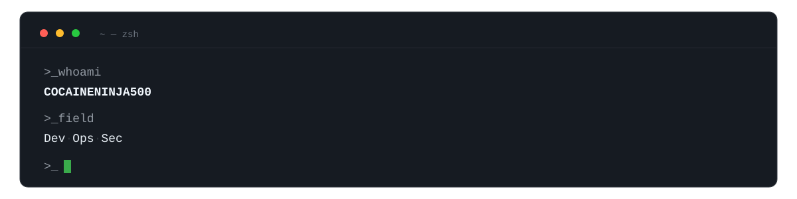

## STACK · 装备

**`>_ dev`**

**`>_ ops`**

**`>_ sec`**

## FIELD · 方向

- `>_` **dev** — python / go / typescript 应用与工具 apps & tools
- `>_` **ops** — 部署 · 容器 · 自动化 deploy · containers · automation
- `>_` **sec** — web 安全 · 渗透 · osint

EOF · © COCAINENINJA500

