<div align="center">


<br/>


</div>

## ⚡ STACK · 技术栈

<div align="center">


</div>

## 🛰 FOCUS · 正在专注

- 🔭 **网络安全 & 渗透测试** 深入学习中 · going deep into cybersecurity & pentesting
- 🛠 用 **Python / Go / TypeScript** 造实用的东西 · building tools that do real work
- 🎧 背景音：lo-fi beats & 808s · background music on loop

```bash
$ echo "bW9uZXkgdGFsa3M=" | base64 -d
money talks

$ git commit -m "ship it" && git push
```


